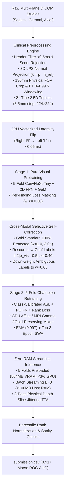

# RSNA Knee Abnormality Detection — 0.917 Solution

An end-to-end **5-Fold Two-Stage ConvNeXt-Tiny 2.5D** solution for multi-label knee MRI abnormality classification across **12 target pathologies**, achieving **0.917 Macro ROC-AUC** on the Kaggle leaderboard (**0.9227** mean 5-fold validation Macro ROC-AUC across **4,407** studies and **0.9193** on the **58** radiologist-verified Gold Standard cases).

**Target Pathologies (12):** `ACL`, `MCL`, `Medial Meniscus`, `Lateral Meniscus`, `Medial OA`, `Lateral OA`, `PF OA`, `Effusion`, `Synovitis`, `Baker's`, `Contusion`, `Fracture`.

---

## Repository Structure

This repository contains the complete 3-stage pipeline from raw DICOM preprocessing to two-stage training and offline Kaggle submission:

| Notebook | Role | Key Highlights |
| :--- | :--- | :--- |
| [`rsna-data-preprocessed.ipynb`](rsna-data-preprocessed.ipynb) | **V3.0 Physics-Driven Preprocessing** | 130 mm physical FOV crop, 3D LPS normal projection, 3.5 mm 2.5D triplets (`21 slices @ 224×224`). |
| [`rsna-2-stage.ipynb`](rsna-2-stage.ipynb) | **5-Fold Two-Stage Training** | Stage 1 masked visual pretraining, Cross-Modal Selective Self-Correction, Stage 2 SWA + EMA retraining. |
| [`rsna-convnext-inference.ipynb`](rsna-convnext-inference.ipynb) | **100% Offline Streaming Inference** | All 5 folds preloaded in `564.0 MB` VRAM, `B=8` zero-RAM streaming (`<100 MB` RAM), 3-pass depth jitter TTA. |

---

## End-to-End Pipeline Overview

---

## Key Technical Highlights

### 1. Physics-Driven Clinical Preprocessing (`rsna-data-preprocessed.ipynb`)

Knee MRI datasets exhibit severe scanner heterogeneity (1.5T vs. 3.0T, arbitrary slice ordering, varying pixel spacing, and Left/Right laterality mirroring). The preprocessing engine standardizes raw DICOM volumes using clinical geometry:

- **Fast Header Inspection (`< 0.5 ms`):** Reads DICOM metadata via `pydicom.dcmread(..., stop_before_pixels=True)`. Hard-rejects non-diagnostic localizers (`scout`, `loc`, `survey`), deprioritizes suboptimal series (`repeat`, `redo`, `motion`, `corrupt`), and classifies sequences into 4 contrast types (`FS`, `T1`, `NOFS_FLUID`, `OTHER`) using word-boundary regexes (avoiding `fse` → `fs` false positives).
- **Deterministic Series Selection:** Selects the optimal series per plane via:
  $$\text{Priority} = (\text{is\_clean} \times 10000) + (\text{is\_FS} \times 1000) + (\text{is\_PD} \times 100) + (\text{is\_T2} \times 20) + N_{\text{slices}}$$
- **3D LPS Normal Vector Projection & Diversity Gate:** Computes unit slice normals from `ImageOrientationPatient` and projects `ImagePositionPatient` onto the reference normal ($k_i = \vec{p}_i \cdot \vec{n}_{\text{ref}}$), eliminating 180° vendor-dependent slice inversions. Duplicate/multi-echo slices within `0.01 mm` are merged.
- **Standardized `130 mm × 130 mm` Physical FOV Crop:** Computes exact pixel bounding boxes from `PixelSpacing`, applies symmetric reflection padding (`cv2.BORDER_REFLECT`) if needed, normalizes intensity using volume-level percentiles $[P_{1.0}, P_{99.5}]$, and resizes to `224 × 224`.
- **True 2.5D Physical Depth Triplets (`21 × 3 × 224 × 224`):** Samples **7 Sagittal** (`[8%, 92%]`), **7 Coronal** (`[18%, 82%]`), and **7 Axial** (`[10%, 90%]`) positions. Instead of fixed index offsets, each 3-channel triplet uses a physical **`3.5 mm`** step ($k - 3.5\text{ mm}, k, k + 3.5\text{ mm}$, ~7 mm total span).
- **3-Tier Laterality Normalization:** Determines knee laterality from DICOM tags (`ImageLaterality`/`Laterality`), 3D LPS knee center coordinate $c_x$ ($\pm 15.0\text{ mm}$), and protocol strings, then flips all Right (`R`) knees to canonical Left (`L`) orientation on GPU in `< 0.05 ms`.

### 2. Model Architecture (`ConvNeXt25DModel`)

- **Backbone:** `convnext_tiny.in12k_ft_in1k` (`timm`) with `DropPath = 0.08` and top 2 stages (Stages 2 & 3) unfrozen.
- **2D Top-Down Channel-Gated FPN:** Fuses Stage 3 (`14×14`, 384-dim) and Stage 4 (`7×7`, 768-dim) in 2D spatial feature map space prior to pooling, with a learned channel gate (`fpn_gamma_init = 0.05`).
- **Trainable GeM Spatial Pooling:** Generalized Mean pooling ($p \in [1.0, 10.0]$, initialized at `3.0`, zero weight decay) to emphasize focal tear peaks without diluting across background joint tissue.
- **Warm-Start Residual Anatomical Gaussian Slot Prior:** Clinically anchored $(\mu_0, \sigma_0, \pi_0)$ over normalized slice depth $s \in [0, 1]$ for all 12 pathologies across 3 planes, with bounded `tanh` residual drift and a dedicated fast learning rate (`5e-3`).
- **Plane-Decoupled Hierarchical Dual-Scale Attention:**
  - *Level 1 (Intra-Plane):* Combines sharp focal slice attention and broad context smoothing ($\tau = 2.0$) per plane.
  - *Level 2 (Inter-Plane):* Routes finding-specific attention across Sagittal, Coronal, and Axial views biased by the Gaussian slot prior, regularized with **Whole-Plane Dropout (`p = 0.20`)** during training.
- **Hyperspherical Cosine Metric Classifier & Aux Head:** Normalized cosine similarity logits prevent gradient saturation on rare findings, paired with an auxiliary 4-class contrast classification head (`aux_contrast_weight = 0.10`).

### 3. Two-Stage Cross-Modal Self-Correction (`rsna-2-stage.ipynb`)

Training data relies on weak/soft LLM report labels (`llm_labels_v4_blend.csv`) alongside **58** radiologist-verified Gold Standard studies, split via 5-fold `MultilabelStratifiedKFold` (`4,407` total studies: ~881–882 studies and 11–12 Gold cases per fold).

- **Stage 1 (Pure Visual Pretraining):** Trains 5 folds with per-finding loss masking on low-confidence/unmentioned labels (`w <= 0.30`) so the visual backbone is not corrupted by missing-mention false negatives.
- **Cross-Modal Selective Self-Correction:**
  1. **Gold Standard Protection:** All 58 Gold studies remain 100% untouched (`w = 1.0`, `3.0×` loss weight).
  2. **Confident Labels (`w > 0.30`):** Soft-blended between LLM text labels and Stage 1 OOF visual predictions.
  3. **Low-Confidence Labels (`w <= 0.30`):** Rescued by the visual model when $c_{\text{vis}} = 2|p_{\text{vis}} - 0.5| \ge \tau$ ($\tau = 0.40$); otherwise down-weighted to `0.05` to suppress noise.
- **Stage 2 (Champion Retraining):** Retrains on the refined labels using **Class-Calibrated Asymmetric Loss (ASL)** + **Auto-Calibrated PU False-Negative Weights** + **Soft-Margin Rank Loss** (`w = 0.15`), GPU-vectorized augmentations (Affine, MRI Physics Gamma, Gold-Preserving 2.5D Mixup), **EMA (`0.997`)**, and **Top-3 Epoch SWA**.

### 4. Zero-RAM Streaming Offline Inference (`rsna-convnext-inference.ipynb`)

- **Multi-Fold VRAM Preloading:** All 5 ConvNeXt-Tiny fold checkpoints are loaded into GPU VRAM simultaneously (**`564.0 MB`**, `< 3%` of a 16 GB GPU), avoiding 5× redundant disk I/O.
- **Zero-RAM Generator Streaming:** Streams hidden test studies in small batches (`batch_size = 8`, `< 100 MB` peak host RAM) to prevent OOM crashes across thousands of unseen DICOM series.
- **3-Pass Physical Depth Slice-Jittering TTA:** Evaluates Nominal (`1.0`), Forward Jitter (`+3.5 mm`, `0.5`), and Backward Jitter (`-3.5 mm`, `0.5`) passes from a single cached slice read (`1×` disk I/O), followed by GPU laterality alignment, column-wise percentile rank normalization (`scipy.stats.rankdata`), and strict submission sanity assertions.

---

## Validation & Competition Results

- **Kaggle Leaderboard Score:** **0.917 Macro ROC-AUC**

### Stage 1 vs. Stage 2 (5-Fold Out-Of-Fold Summary)

| Evaluation Metric | Stage 1 (Raw / Rank-Norm) | Stage 2 (Raw / Rank-Norm) | Gain |
| :--- | :---: | :---: | :---: |
| **Mean of Folds Macro AUC** | `0.8936` | **`0.9227`** | **`+0.0291`** |
| **Pooled Confident OOF (`w > 0.3`)** | `0.8912` / `0.8920` | **`0.9223` / `0.9226`** | `+0.0306` |
| **Pooled Full All-Data (4,407 studies)** | `0.8763` / `0.8771` | **`0.9196` / `0.9199`** | `+0.0428` |
| **Official 58 Gold Standards** | `0.8991` / `0.9019` | **`0.9193` / `0.9184`** | `+0.0165` |

**Stage 2 Per-Fold Macro ROC-AUC:** Fold 0: `0.9231` | Fold 1: `0.9238` | Fold 2: `0.9221` | Fold 3: `0.9219` | Fold 4: `0.9228`.

### Stage 2 Per-Pathology OOF Breakdown

| Target Pathology | Confident OOF (`Raw → Rank`) | Full 4,407 (`Raw → Rank`) | 58 Gold Standards (`Raw → Rank`) |
| :--- | :---: | :---: | :---: |
| `ACL` | `0.9156 → 0.9151` | `0.9105 → 0.9101` | `0.9779 → 0.9718` |
| `MCL` | `0.8690 → 0.8702` | `0.8667 → 0.8678` | `0.9592 → 0.9615` |
| `Medial Meniscus` | `0.9527 → 0.9525` | `0.9498 → 0.9496` | `0.9808 → 0.9748` |
| `Lateral Meniscus` | `0.9250 → 0.9256` | `0.9201 → 0.9206` | `0.8708 → 0.8795` |
| `Medial OA` | `0.9260 → 0.9264` | `0.9248 → 0.9252` | `0.9845 → 0.9876` |
| `Lateral OA` | `0.8971 → 0.8978` | `0.8939 → 0.8945` | `0.8259 → 0.8375` |
| `PF OA` | `0.8883 → 0.8885` | `0.8866 → 0.8868` | `0.8456 → 0.8456` |
| `Effusion` | `0.8933 → 0.8938` | `0.8931 → 0.8935` | `0.9168 → 0.9155` |
| `Synovitis` | `0.9742 → 0.9740` | `0.9704 → 0.9701` | `0.8029 → 0.7897` |
| `Baker's` | `0.9436 → 0.9441` | `0.9435 → 0.9440` | `0.9873 → 0.9855` |
| `Contusion` | `0.9372 → 0.9381` | `0.9315 → 0.9324` | `0.9568 → 0.9528` |
| `Fracture` | `0.9452 → 0.9452` | `0.9438 → 0.9438` | `0.9236 → 0.9194` |

---

## Training & Inference Configuration

| Parameter | Value | Notes |
| :--- | :--- | :--- |
| **Input Tensor** | `(21, 3, 224, 224)` | 7 Sagittal + 7 Coronal + 7 Axial (`3.5 mm` 2.5D triplets) |
| **Batch Size / Precision** | `16` (Train) / `8` (Infer) | `FP16 AMP` + `NHWC channels_last` |
| **Schedule** | `11` epochs, `20%` warmup | Cosine decay, early stopping patience `2` |
| **Learning Rates** | Backbone `2.8e-5`, Head `1.5e-3`, Prior `5.0e-3` | Prior & GeM `p` use zero weight decay |
| **Regularization** | `weight_decay = 0.05`, `dropout = 0.35` | `DropPath = 0.08`, Whole-Plane Dropout `0.20` |
| **Model Averaging** | `EMA (0.997)` + `Top-3 SWA` | SWA overwrites single-best if validation AUC improves |

---

## How to Run

### Prerequisites
- Python 3.10+ with `torch`, `timm`, `pydicom`, `opencv-python-headless`, `scikit-learn`, `scipy`, `pandas`, `numpy`, `iterative-stratification`.
- Competition DICOM dataset (`rsna-knee-abnormality-detection`) and soft LLM labels (`llm_labels_v4_blend.csv`).

### Execution Order
1. **Preprocess DICOM Volumes:** Run [`rsna-data-preprocessed.ipynb`](rsna-data-preprocessed.ipynb) to generate the memory-mappable `knee_train_21slices_224.npy` tensor archive and `train_metadata_21slices.csv`.
2. **Train 5-Fold Two-Stage Models:** Run [`rsna-2-stage.ipynb`](rsna-2-stage.ipynb) to execute Stage 1 pretraining, Cross-Modal Selective Self-Correction (`llm_labels_v5_refined.csv`), and Stage 2 SWA retraining, saving `best_convnext_tiny_kaggle_fold{0..4}.pth`.
3. **Offline Inference & Submission:** Attach the 5 trained checkpoints to [`rsna-convnext-inference.ipynb`](rsna-convnext-inference.ipynb) and run with internet disabled on Kaggle to stream test DICOMs and output `submission.csv`.
